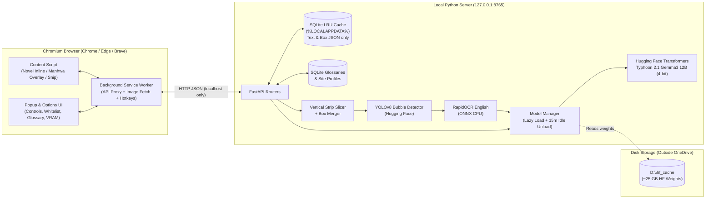
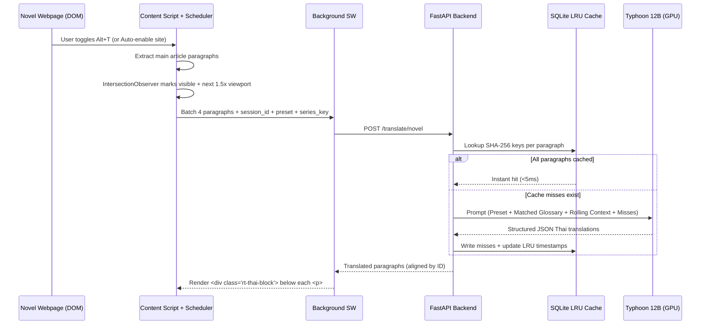
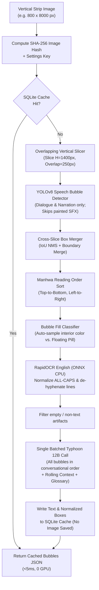
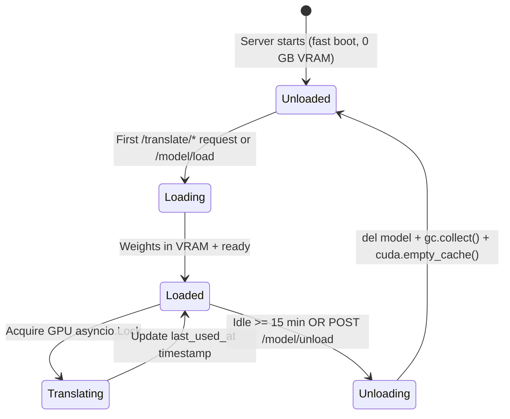

# System Architecture — Real-Time EN→TH Novel & Manhwa Translator

This document describes the end-to-end architecture, processing pipelines, GPU VRAM budget, SQLite LRU cache schema, and context/glossary design for `realtime-translator`.

---

## 1. High-Level System Overview



### Architectural Boundaries
1. **Browser Extension stays thin & lightweight:**
   - Stores only lightweight preferences in `chrome.storage.local` (auto-enable site whitelist, typography styling, hotkeys, active preset ID).
   - Never stores translation caches or image binaries in browser storage, preventing browser profile bloat over months of use.
   - All `http://127.0.0.1:8765` calls route through the **Background Service Worker** so HTTPS reading websites with strict Content-Security-Policy (CSP) headers cannot block localhost requests.
2. **Single unified local Python server:**
   - Hosts both the **Computer Vision / OCR pipeline** and the **Hugging Face LLM** in one process launched via `start.bat`.
   - Binds strictly to `127.0.0.1:8765` (never exposed to LAN).

---

## 2. Web Novel Pipeline (Bilingual Inline)



### Key Novel Design Details
- **DOM Extraction (`extractor.ts`):** Identifies the main reading container using text-density scoring (`<article>`, `.chapter-content`, or highest paragraph-cluster container) while ignoring `<nav>`, `<header>`, `<footer>`, comment widgets, and buttons.
- **Non-Destructive Injection (`renderer.ts`):** Inserts a sibling `<div class="rt-thai-block" data-rt-for="id">` immediately below each English paragraph. Toggling translation off flips a root CSS class (`rt-hidden`) for instant zero-cost hide/show without re-translating.
- **Scroll-Ahead Pre-Fetching (`scheduler.ts`):**
  - Priority Queue Tier 0: Currently visible viewport paragraphs.
  - Priority Queue Tier 1: Next ~1.5 viewports below scroll position (pre-fetched silently so scrolling down hits already-rendered Thai).
  - AbortController cancels queued batches if the user jumps to another chapter or toggles off.

---

## 3. Vertical Long-Strip Manhwa / Webtoon Pipeline

Optimized specifically for **full-color vertical scrolling manhwa/webtoons** (top-to-bottom, left-to-right reading order).



### Key Manhwa Engineering Decisions
1. **Overlapping Vertical Slicing (`strip_slicer.py`):**
   - Standard YOLOv8 resizes inputs to square tensors (e.g. `1024×1024`), which squashes an `800×8000px` webtoon strip into unreadable slivers.
   - Any image with `height > 1.8 * width` is sliced into overlapping horizontal bands (`slice_height = 1400px`, `overlap = 250px`).
   - Detections mapped back to full-image coordinates go through **cross-slice deduplication** (IoU > 0.45 or >70% containment merges into the cleaner box), ensuring bubbles crossing a slice seam are never cut in half or translated twice.
2. **Reading Order (Manhwa / Webtoon LTR):**
   - Bubbles are clustered into vertical reading bands (if `abs(y1_a - y1_b) < 0.4 * min(h_a, h_b)` they share a row), then ordered **top-to-bottom, left-to-right**.
3. **Bubble Masking & SFX Policy (`bubble_detector.py` + `overlay.ts`):**
   - `ogkalu/comic-speech-bubble-detector-yolov8m` targets dialogue bubbles and narration boxes, leaving painted background artwork SFX untouched.
   - **Auto-colored solid mask:** Samples border pixels just inside the bubble contour (excluding text strokes via median/mode clustering). If color variance is low (standard white, black, or flat-tinted bubble), returns `render_mode: "mask"` with `bg_color` and high-contrast `text_color`.
   - **Floating text fallback:** If interior background variance is high (text directly over detailed colored art), returns `render_mode: "pill"` so the extension draws a clean semi-transparent dark/light rounded badge instead of an ugly solid rectangle.
4. **Thai Auto-Fit & Instant Peek (`overlay.ts`):**
   - Overlay boxes use normalized `[0.0 .. 1.0]` coordinates relative to each ``, so browser zoom or window resizing keeps masks perfectly aligned.
   - Font size is binary-searched (`10px` to `22px`) to fit cleanly inside each bubble using Thai word-boundary wrapping (`Intl.Segmenter("th")` + `overflow-wrap: break-word`).
   - Hovering over a bubble or holding `Alt+O` smoothly hides the mask (`opacity: 0`) so you can peek at the original English immediately.
5. **Manual Region Snip Fallback (`snipTool.ts`):**
   - Pressing `Alt+S` activates a crosshair drag selector for any missed stylized bubble, DRM `<canvas>` panel, or image block.
   - Captures the exact viewport rectangle via `chrome.tabs.captureVisibleTab`, sends the small crop to `POST /translate/snip`, runs RapidOCR directly (bypassing bubble filtering), translates via Typhoon 12B, and pops up a clean Thai card next to the crop.

---

## 4. GPU VRAM Budget & Idle Auto-Unload Lifecycle

Hardware baseline: **NVIDIA GeForce RTX 5060 Ti — 16,311 MiB (~16 GB VRAM)**, PyTorch `2.10.0+cu128`.

### Steady-State VRAM Budget

| Component | Device | Estimated VRAM | Notes |
|---|---|---|---|
| `typhoon-ai/typhoon2.1-gemma3-12b` (4-bit NF4, BF16 compute) | GPU (CUDA 12.8) | ~8.5 – 9.5 GB | Weights + quantization overhead |
| KV Cache & Generation Buffers (batch context ≤ 4k tokens) | GPU (CUDA 12.8) | ~1.0 – 1.8 GB | Bounded by `max_new_tokens` and context cap |
| `ogkalu/comic-speech-bubble-detector-yolov8m` (FP16) | GPU (or CPU option) | ~0.3 – 0.6 GB | Very fast (~40–80ms/slice on RTX 5060 Ti) |
| `RapidOCR` (ONNX Runtime English PP-OCR) | CPU (12 cores) | **0.0 GB** | Runs in ~100–250ms per slice on CPU, leaving max VRAM headroom |
| **Total Active Peak** | **GPU** | **~10.0 – 12.0 GB** | Leaves **4–6 GB free safety margin** on 16 GB GPU |

### Model Lifecycle State Machine



- **Lazy Startup:** Launching `start.bat` starts FastAPI in ~1–2 seconds without blocking on a 12B weight load. You can browse normally with 0 VRAM used until your first translation (or click **Load Model** in the popup).
- **Concurrency Safety:** A single `asyncio.Lock` serializes GPU inference calls so rapid scrolling across multiple tabs never causes concurrent CUDA OOM spikes.
- **Auto-Unload Watchdog:** Every 30 seconds, a background task checks `(now - last_used_at) >= IDLE_UNLOAD_MINUTES` (default 15). When idle, it frees the LLM (and YOLO detector) cleanly so games or other GPU workloads immediately recover all 16 GB VRAM.

---

## 5. Consistency Architecture: Presets, Rolling Context & Glossary

### 1. Genre Tone Presets
| Preset ID | Display Name | Thai Style & Pronoun Guidance |
|---|---|---|
| `modern_manhwa` | Modern Manhwa / Action / Romance | Natural colloquial Thai dialogue (*ฉัน/นาย/เธอ/ผม/แก/พี่/น้อง*), concise bubble-sized phrasing, preserves attitude & slang |
| `fantasy_murim` | Fantasy / Murim / Isekai / Regression | Martial/fantasy register (*ข้า/เจ้า/ท่าน/ผู้น้อย/ศิษย์พี่*), evocative skill & system-window terminology |
| `light_novel` | Light Novel / Literary Prose | Smooth Thai narrative flow, natural sentence connectors, faithful internal monologue |
| `literal` | Literal / Reading Aid | Closer structure to English source for comparing idioms and phrasing |

### 2. Automatic Rolling Context
- Keyed by `session_id` (generated per tab/chapter in the extension; reset on URL path change).
- Stores the **last 8 translated EN → TH pairs** in server RAM (capped at ~600 tokens).
- Passed in the system/context prompt as read-only reference so ongoing dialogue retains speaker gender, politeness level, and pronouns across consecutive batches and strips.

### 3. Selective Per-Series Glossary
- Stored in SQLite (`glossaries` table), optionally auto-matched by URL pattern (e.g., `asuracomic.net/series/solo-leveling/*`).
- Each entry has `{ source, target, category ("name" | "skill" | "place" | "pronoun" | "term"), note }`.
- Before constructing each LLM prompt, `prompt_builder.py` performs case-insensitive substring/word matching against the current input batch + rolling context and injects **only matching terms** (plus any global `pronoun` rules for that series). This keeps prompts short, fast, and focused.

---

## 6. Storage & Bounded SQLite LRU Cache Design

### File Locations (OneDrive-Safe)
- **Hugging Face Model Weights (`HF_HOME`):** `D:\hf_cache` (avoids filling `C:` and stays completely outside `OneDrive\Desktop`).
- **SQLite Databases (`CACHE_DB_PATH`, `GLOSSARY_DB_PATH`):** `%LOCALAPPDATA%\realtime-translator\translator.db` (outside OneDrive to prevent SQLite WAL sync lock errors).

### SQLite Schema Summary
```sql
-- Bounded translation cache (text & normalized box JSON only; NEVER raw images)
CREATE TABLE translation_cache (
    cache_key       TEXT PRIMARY KEY,  -- SHA-256(mode|content_hash|model_id|preset|glossary_hash)
    mode            TEXT NOT NULL,     -- 'novel' | 'manhwa' | 'snip'
    payload_json    TEXT NOT NULL,     -- Translated text or bubble boxes JSON
    byte_size       INTEGER NOT NULL,
    created_at      INTEGER NOT NULL,  -- Unix epoch seconds
    last_accessed   INTEGER NOT NULL   -- Updated on every hit for LRU eviction
);
CREATE INDEX idx_cache_lru ON translation_cache(last_accessed ASC);
CREATE INDEX idx_cache_created ON translation_cache(created_at ASC);

-- Per-series glossaries
CREATE TABLE glossaries (
    id              TEXT PRIMARY KEY,
    name            TEXT NOT NULL,
    url_pattern     TEXT DEFAULT '',
    default_preset  TEXT DEFAULT 'modern_manhwa',
    updated_at      INTEGER NOT NULL
);

CREATE TABLE glossary_entries (
    id              INTEGER PRIMARY KEY AUTOINCREMENT,
    glossary_id     TEXT NOT NULL REFERENCES glossaries(id) ON DELETE CASCADE,
    source_term     TEXT NOT NULL,
    target_term     TEXT NOT NULL,
    category        TEXT NOT NULL DEFAULT 'term',
    note            TEXT DEFAULT ''
);
```

### Bounded LRU Eviction Policy
- **TTL Pruning:** On write (throttled to once per minute) and on startup, delete rows where `now - created_at > CACHE_TTL_DAYS * 86400` (default **30 days**).
- **Size Cap Pruning:** If `SUM(byte_size) > CACHE_MAX_MB * 1024 * 1024` (default **50 MB** — enough for tens of thousands of novel paragraphs and thousands of manhwa strips since only tiny JSON is stored), delete oldest `last_accessed` rows until usage drops below 85% of cap, running `PRAGMA incremental_vacuum` periodically.
- **Instant User Reset:** `POST /cache/clear` wipes `translation_cache` and runs `VACUUM` in milliseconds.
